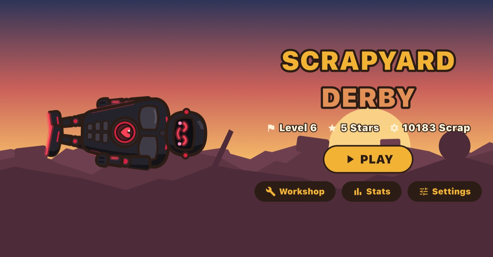
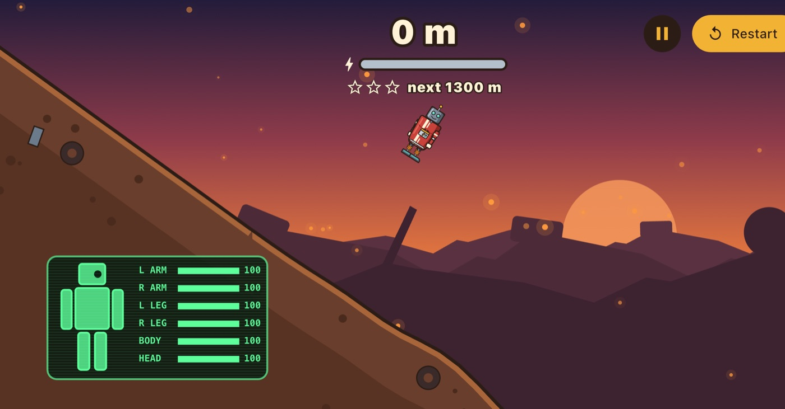
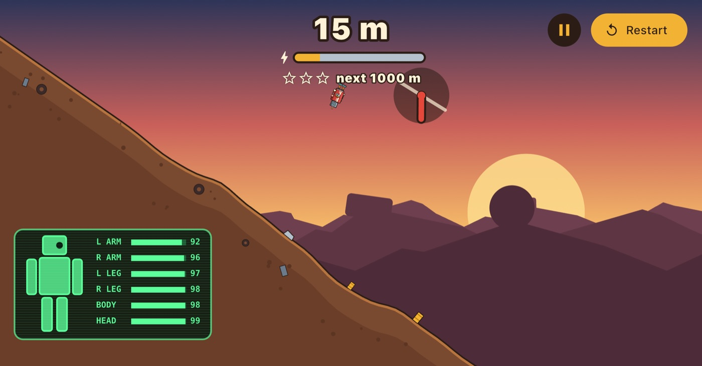
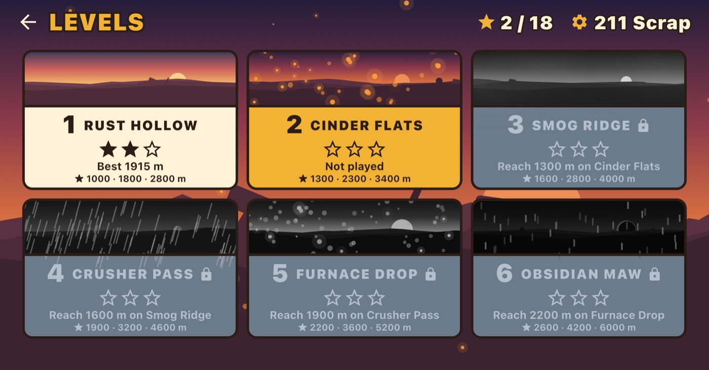
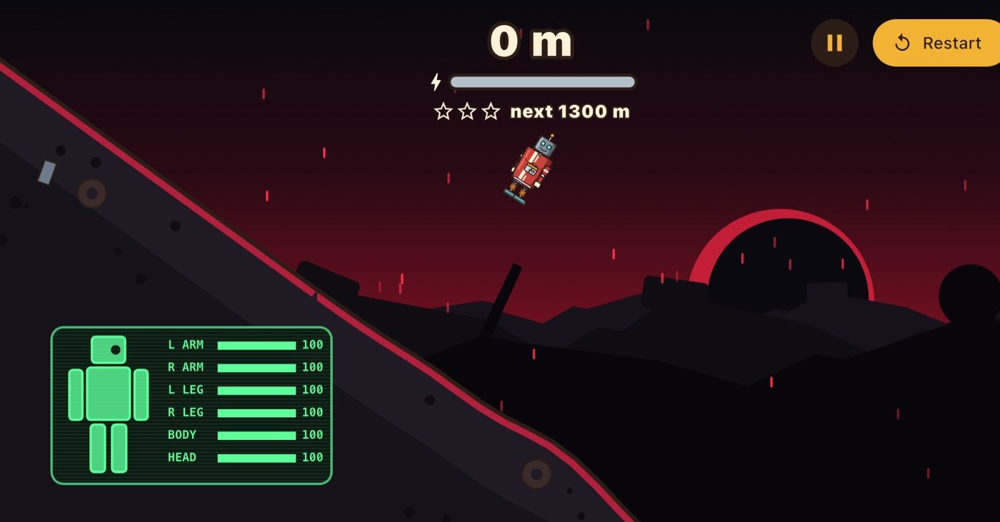
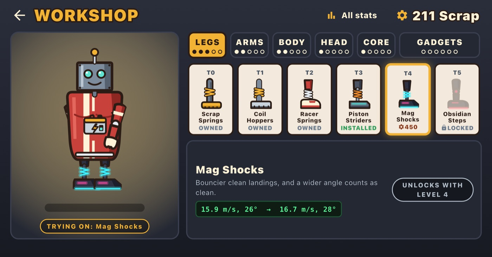
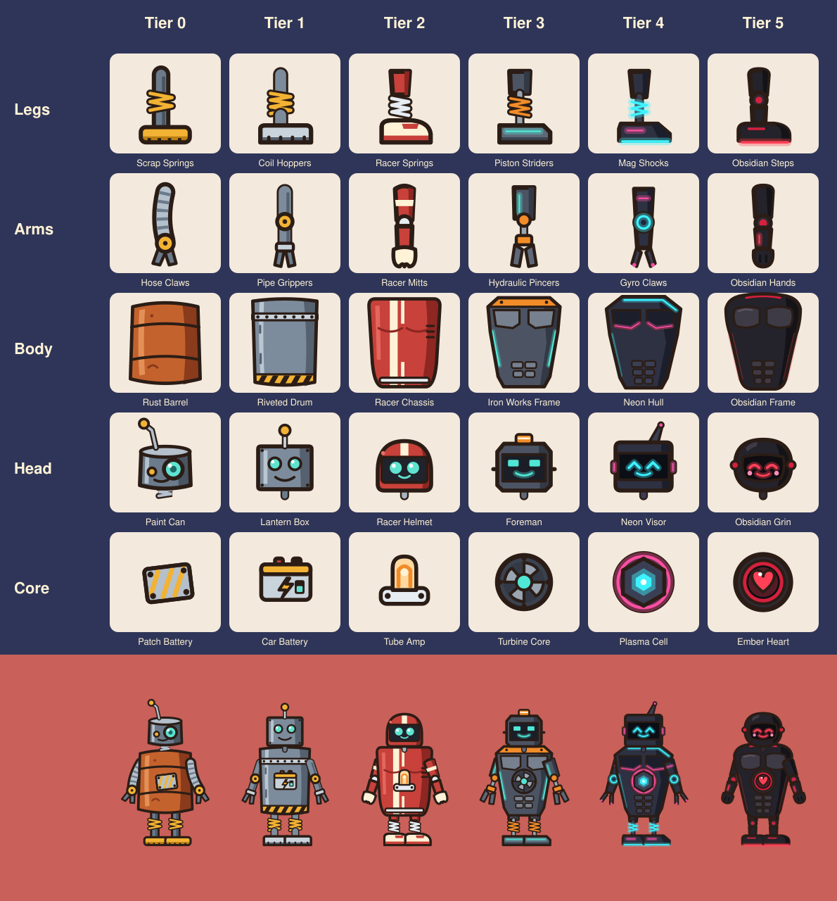
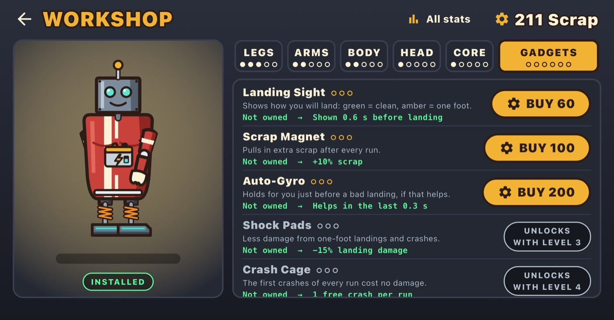

<div align="center">



# Scrapyard Derby

**One thumb. One junkyard robot. One very long hill.**

A physics-driven, one-button downhill game: spin, land on your feet, bounce higher,
and see how far your robot gets before it falls apart.


### [▶ Play in your browser](https://athanasiospapazoglou.github.io/scrapyard_derby/)

<sub>Plays in portrait or landscape. Your progress is saved in your browser.</sub>

</div>

---

## How it plays

Your robot is dropped onto a steep, bumpy hill of scrap and starts **spinning clockwise on its own**.
**Hold anywhere on the screen** to counter-spin. That's the whole control scheme.

- 🦿 **Land on both feet** for a big bounce and more speed. One foot costs you speed; anything else is a crash.
- 🌀 **Spin in the air** to charge energy. Every turn adds height to your next bounce, so brave spins mean huge jumps.
- 🔩 **Bad landings break you apart.** Arms go first, then legs.
- 🚀 **Out of limbs?** Your head fires off like a rocket along your line of travel for one last flight. Where it lands is your score.
- 🎯 **Not sure how you'll land?** The built-in **Landing Sight** shows it just before touchdown: a gauge beside the robot
  and a marker on the ground, green for clean, amber for one foot, red for a crash. (Settings can hide it.)

The feel is deliberately calm and floaty: the whole game runs a little slowed down, the jumps are tall,
and the camera zooms out to keep both the robot and the ground in view, drawing the robot bigger the higher it flies
so it never shrinks to a speck.

<div align="center">


</div>

## Six levels, each one meaner

Every level is an endless hill with a distance goal. Reach it to earn the first star and unlock the next level.
Go further for the second and third stars. Stars boost every scrap reward for good.
Later hills are steeper and bumpier, hit harder, and look and sound darker.

<div align="center">

</div>

| # | Level | Sky | Weather | Music |
|:-:|---|---|---|---|
| 1 | **Rust Hollow** | warm dusk | clear | *Scrapyard Dusk*: easy lo-fi |
| 2 | **Cinder Flats** | late dusk, low red sun | drifting embers | *Cinder Wind* |
| 3 | **Smog Ridge** | night, sickly moon | green smog banks | *Smog Lanterns*: eerie drone |
| 4 | **Crusher Pass** | storm-red | rain and lightning | *Crusher Storm*: driving and metallic |
| 5 | **Furnace Drop** | molten orange, black heaps | ash and embers | *Furnace Heart*: gritty and heavy |
| 6 | **Obsidian Maw** | black, crimson eclipse | crimson sparks | *Obsidian Maw*: slow heartbeat |

<div align="center">

</div>

## Build a better robot

Every run pays out **scrap**. Spend it in the **Workshop** on five part slots
(legs, arms, body, head, core), each with six tiers from a rusty paint can to obsidian armor.
Each level you unlock opens the next tier, and your robot wears whatever you install.

Every part comes with a little spec sheet (what it's made of, how it works) and changes two or three real stats:

| Slot | Stats |
|---|---|
| 🦿 **Legs** | **Jump** (clean bounce), **Landing window** (how tilted still counts as clean), **Grip** (speed kept on one foot) |
| 🦾 **Arms** | **Flip speed** (swinging the spin around), **Recovery** (spinning back when you let go) |
| 🛢️ **Body** | **Toughness** (damage before a part breaks), **Crash armor** (speed kept when you crash) |
| 🤖 **Head** | **Rocket power**, **Rocket burn** and **Thrust** for the final flight |
| 🔋 **Core** | **Spin power**, **Energy tank**, and **Overdrive** (spin energy that also shoots you forward) |

<div align="center">

<br><br>

</div>

Struggling? **Gadgets** are there to help, not just to make good players better:

| Gadget | What it does |
|---|---|
| 🔁 **Combo Coil** | Clean landings in a row stack extra bounce and speed |
| 🧲 **Scrap Magnet** | More scrap from every run |
| 🌀 **Auto-Gyro** | Holds for you just before a bad landing, if that helps |
| 🛞 **Shock Pads** | Softens one-foot landings and crashes |
| 🛡️ **Crash Cage** | Your first crashes each run cost nothing |
| 🪜 **Leveler Treads** | Sharp bumps count less when your landing is judged |

<div align="center">

</div>

A **Robot Stats** screen shows every stat as a gauge against its maximum, with what the next part would bring,
plus your stars and scrap bonuses.

## Everything is made by code

No stock assets anywhere. All art, sound and music is original and generated by small,
standard-library Python scripts in [`art/`](art/):

| Script | Makes |
|---|---|
| `make_style_test.py` | the cutout art style and the base robot sprites |
| `make_parts.py` | all 30 Workshop parts (vector SVGs, drawn around their joint pivots) |
| `make_sfx.py` | retro synth sound effects: landings, limb breaks, the rocket |
| `make_music.py` | seven music loops (one for the menus, one per level), seamless and deterministic |

The scenery (sky, parallax scrap heaps, dirt, weather particles) is drawn in code, one colour theme per level.

## Run it

The quickest way is the [browser version](https://athanasiospapazoglou.github.io/scrapyard_derby/),
which is rebuilt and published automatically on every push to `main`
(see [`.github/workflows/deploy-web.yml`](.github/workflows/deploy-web.yml)).

To run it yourself you'll need [Flutter](https://docs.flutter.dev/get-started/install) (Dart 3) and a phone, emulator, simulator or browser.

```bash
flutter pub get
flutter run
```

The game plays in portrait and landscape. In debug builds, **Settings → Developer → Unlock everything**
maxes the robot and opens every level, handy for trying the later hills.

**Tests and tools**

```bash
flutter analyze
flutter test                                     # unit, widget and headless-physics tests
flutter test tool/simulate_runs_test.dart        # balance report: bots of different skill
flutter test tool/progression_report_test.dart   # every level × tier × skill (slow)
flutter test tool/head_flight_report_test.dart --timeout none   # how far the launched head flies
```

The balance tools play full runs of the real game, physics and all, with an autopilot
that misjudges landings and rough ground in line with its skill.

**Regenerate the assets**

```bash
python3 art/make_style_test.py art assets/robot
python3 art/make_parts.py
python3 art/make_sfx.py
python3 art/make_music.py
```

## Under the hood

- **[Flutter](https://flutter.dev) + [Flame](https://flame-engine.org) + [flame_forge2d](https://pub.dev/packages/flame_forge2d)** (Box2D v3)
- The robot is six physics bodies (torso, head, two arms, two legs) on revolute joints; broken limbs really detach
- An endless hill built from formula-driven chain-shape chunks, streamed in ahead and removed behind
- Every gameplay number in one place: [`lib/config/tuning.dart`](lib/config/tuning.dart)
- Saves through `shared_preferences`, with versioned JSON

| Where | What |
|---|---|
| `lib/game/` | game loop, robot, hill, landings, levels, gadgets, effects, sound |
| `lib/ui/` | menu, level select, HUD, run summary, Workshop, stats, settings |
| `lib/profile/` | saved progress |
| `art/` | asset generators |
| `test/`, `tool/` | tests and balance reports |

## Status

**In development (version 1.1.1).** Fully playable: six levels, stars, Workshop, gadgets, generated art and music.
1.1.1 brought a tighter camera, a clearer landing marker, a head launch that flies true,
part spec sheets with a new stat per slot, and a rebalance so every level is a little meaner than the last.
Next up: an Android build checked on a real phone, then store prep.
The working plan lives in [`docs/ROADMAP.md`](docs/ROADMAP.md).

<div align="center">
<sub>A hobby project. All names, art, sound and code are original.</sub>
</div>
